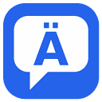
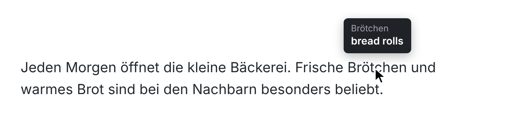

<p align="center">
  
</p>

<h1 align="center">German → English Hover Translator</h1>

<p align="center">
  A lightweight Microsoft Edge extension (it also works in Chrome): rest your mouse on any German word on a web page and its English translation appears in a small tooltip.
</p>

<p align="center">
  
</p>

## Features

- **Hover to translate.** No clicking, selecting or copy-pasting.
- **Short delay (400 ms)** so tooltips don't flicker while you move the mouse around.
- **Understands German words:** umlauts, ß and hyphenated compounds like *E-Mail*.
- **Stays quiet on non-German text.** Hovering English words doesn't pop anything up.
- **Fast repeats.** Translations are cached, so words you've seen before appear instantly.
- **Works on every site**, including embedded frames.
- **One-click on/off** from the toolbar icon.
- **No API key, no account, no tracking.** Plain JavaScript with no build step and no dependencies.

## Installation

The extension isn't on the Edge Add-ons store, so you load it yourself in "developer mode". It takes about a minute.

1. **Download the code:** click the green **Code** button above → **Download ZIP**, and unzip it.
   Or clone it:
   ```bash
   git clone https://github.com/asadal12/german-english-hover-translator.git
   ```
2. Open **`edge://extensions`** in Microsoft Edge.
3. Turn on **Developer mode** (toggle in the bottom-left corner).
4. Click **Load unpacked** and select the folder that contains `manifest.json`.
5. *(Optional)* Click the puzzle-piece **Extensions** button in the toolbar and choose **Show in toolbar** next to HoverTranslate, so the on/off button is always visible.

**Google Chrome:** the same steps work at `chrome://extensions` (the Developer mode toggle is in the top-right corner).

**Updating:** download the new version (or `git pull`), then click **Reload** on the extension's card in `edge://extensions`.

## Usage

| Action | Result |
| --- | --- |
| Rest the mouse on a German word | The English translation appears above the word |
| Move off the word, scroll, click or type | The tooltip disappears |
| Click the toolbar icon | Turns the extension **off** (an `OFF` badge appears); click again to turn it back on. The setting is remembered. |

## How it works

1. `content.js` watches mouse movement on the page. When the pointer rests for 400 ms it uses `document.caretRangeFromPoint()` to find the text under the cursor and expands it to the whole word.
2. It checks that the pointer is really over the word (not in empty space next to it).
3. The word is sent to the background service worker (`background.js`), which asks Google Translate's public endpoint (`translate.googleapis.com`, German → English).
4. The tooltip is drawn inside a closed Shadow DOM so the website's own CSS can't break its look. It's placed above the word, or below it when there's no room at the top of the window.

## Privacy

- To translate, **only the single hovered word** is sent to Google Translate (`translate.googleapis.com`). No page addresses, surrounding text or personal data are sent.
- The only thing stored is the on/off setting, kept locally in your browser.
- There's no analytics or tracking of any kind.

### Permissions

| Permission | Why it's needed |
| --- | --- |
| `storage` | Remember whether the extension is on or off |
| `https://translate.googleapis.com/*` | Fetch translations |
| Content script on all sites | Detect the word under your mouse on any page |

## Project structure

```
├── manifest.json   # Extension manifest (Manifest V3)
├── background.js   # Service worker: fetches translations, toolbar on/off toggle
├── content.js      # Finds the hovered word and shows the tooltip
├── icons/          # Extension icons (16, 32, 48, 128 px)
└── docs/demo.png   # Screenshot used in this README
```

## Customizing

- **Hover delay:** change `HOVER_DELAY` at the top of `content.js` (milliseconds).
- **Other languages:** in `background.js`, change `sl=de` (source) and `tl=en` (target) in the request URL, e.g. `tl=fr` for French. `sl=auto` lets Google detect the source language.
- **Tooltip style:** edit the CSS inside `ensureTooltip()` in `content.js`.

After any change, click **Reload** on the extension card in `edge://extensions`.

## Limitations

- Words are translated **on their own, without the sentence around them**. Words with several meanings (e.g. *Bank* = bank or bench) show the most common one.
- Separable verbs (*fängt … an*) and words split across HTML elements are translated piece by piece.
- Doesn't run inside text input fields, in the browser's built-in PDF viewer, or on browser pages such as `edge://` and the add-ons store.
- It uses Google's free, unofficial translate endpoint. Very heavy use may be rate-limited, and Google could change the endpoint in the future.

## License

[MIT](LICENSE)
